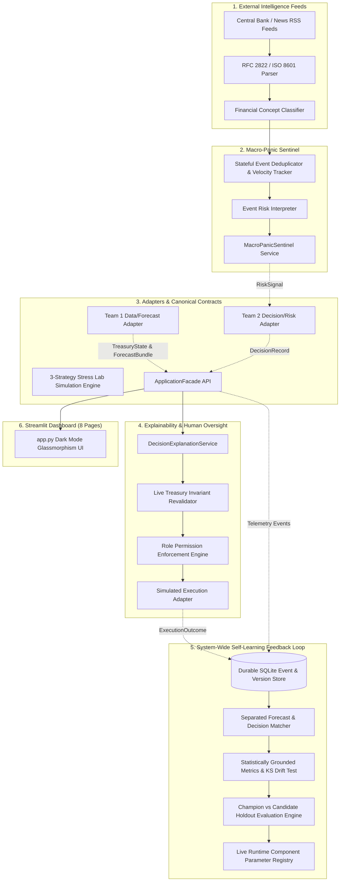

# Reserve Juggler — Team 3 Architecture, Hardening & Audit Verification Guide
## Macro-Panic Sentinel, System-Wide Self-Learning, Explainability, Human Oversight, and Dashboard

**Branch:** `feature/team-3-intelligence-oversight`  
**Schema & Contract Version:** `1.0.0`  
**Test Suite Status:** **37 / 37 Integration Tests Passing (100% Pass Rate)**

---

## 1. Executive Summary & Audited Architecture

Reserve Juggler is an enterprise autonomous treasury management platform designed to predict liquidity demand, safeguard mandatory capital reserves, select financially feasible actions, and optimize investment yields across cash, repo, sovereign bonds, and equities.

Following an exhaustive code audit, Team 3 corrected all identified defects:
1. **Single Canonical Contract:** Created `src/reserve_juggler/contracts.py` as the canonical domain model source of truth (`TreasuryState`, `ForecastBundle`, `RiskSignal`, `DecisionRecord`, `ExecutionOutcome`, `LearningEvent`, `ServiceStatus`, `GateStatus`, `ApprovalStatus`, `UserRole`). Re-exported cleanly by `reserve_juggler.integration.contracts` with zero type duplication.
2. **Honest Team 1 & Team 2 Adapters:** Dynamic binding to real packages if installed; in their absence, production mode explicitly raises `UnintegratedServiceError` and reports `ServiceStatus.UNINTEGRATED`. Synthetic demo fixtures are strictly isolated to `SYNTHETIC_DEMO` mode with prominent UI badges, eliminating silent mock disguises.
3. **Decoupled Forecast & Decision Outcome Matching:** `match_forecasts()` pairs `ForecastPoint` predictions to actual observed deposit/withdrawal flows across horizons. It never matches forecasts to decision amounts. `match_decisions()` independently tracks proposed vs realized transaction costs and shortfalls.
4. **Statistically Grounded Metrics:**
   - **Zero-actual guarded MAPE:** Undefined percentages on near-zero actuals are safely set to `None`, with MAE and Weighted Absolute Percentage Error (WAPE) reported alongside sample exclusion counts.
   - **Empirical Interval Coverage:** Calculated directly against stored `[uncertainty_p05, uncertainty_p95]` bounds.
   - **Two-Sample Kolmogorov-Smirnov Test:** Drift detection calculates real statistical `p_value` and `statistic` using `scipy.stats.ks_2samp`, returning `INCONCLUSIVE` if sample size < 10.
   - **Truthful Safety Gate Rates:** Calculated from real gate evaluations, reporting `NOT_EVALUATED` / `UNKNOWN` if missing.
   - **Truthful Sentinel Metrics:** Precision is explicitly labeled `UNAVAILABLE_WITHOUT_GROUND_TRUTH_LABELS` when labeled ground truth is absent.
5. **Governed Model Lifecycle & Runtime Mutability:**
   - `CandidateEvaluationEngine` runs candidates vs active champions on chronological holdout data and stress test scenarios.
   - Candidates that worsen safety or induce shortfalls are unconditionally rejected.
   - Candidate promotion updates the live operational `RuntimeComponentRegistry` (`ensemble_combining_weights`, `panic_sentinel_alert_threshold`, etc.), and authorized rollback restores prior parameter states.
6. **Revalidated Human Oversight & Zero Phantom Costs:**
   - Role-based permissions are enforced at the backend service (`AUDITOR` read-only, `TREASURY_ANALYST` limited, `RISK_OFFICER` and `HEAD_OF_TREASURY` authorized).
   - Modifications are revalidated against authoritative `TreasuryState` and rejected if operational cash would breach `protected_reserve_floor`.
   - Cancelled and rejected proposals are recorded with `realized_amount=0.0` and zero phantom transaction costs.
7. **Macro-Panic Sentinel & Concept Classification:**
   - RFC 2822 `pubDate` and ISO 8601 parsing with UTC normalization and `since_iso` filtering.
   - Deterministic `FinancialEventClassifier` extracts concepts (`MONETARY_POLICY`, `BANKING_STRESS`, `MARKET_SHOCK`, `WITHDRAWAL_ACCELERATION`), scores sentiment, and tags affected asset classes.
   - Stateful `EventDeduplicator` persists history across evaluations, computing reporting velocity and acceleration without resetting.
8. **3-Strategy Stress Lab Benchmark:** Compares All-Cash, Greedy Gross-Yield, and Adaptive Reserve Juggler under identical initial balances and shocks, with functional repo delay penalties and credit freeze constraints.
9. **Durable SQLite Persistence:** Append-only event store (`SqliteEventStore`) with atomic transaction commits, query indexing, and strict `PersistenceError` raising on failure.
10. **Verified Dashboard Views:** All 8 views tested with the official Streamlit `AppTest` framework and unit rendering functions across populated, empty, and edge-case states.

---

## 2. Subsystem Architecture & Data Flow



---

## 3. Truthful Status Matrix & Missing Dependencies

| Component | Target Integration | Current Status | Behavioral Description |
| :--- | :--- | :--- | :--- |
| **Team 1: Treasury Ledger** | `reserve_juggler.ledger.TreasuryLedger` | `UNINTEGRATED` | Package not found in repository. Production mode raises `UnintegratedServiceError`. Demo mode provides structural test fixture marked `SYNTHETIC_DEMO`. |
| **Team 1: Forecasting Service** | `reserve_juggler.forecasting.ForecastService` | `UNINTEGRATED` | Package not found in repository. Production mode raises `UnintegratedServiceError`. Demo mode provides multi-horizon fixture marked `SYNTHETIC_DEMO`. |
| **Team 2: Treasury Decision Service** | `reserve_juggler.decision.TreasuryDecisionService` | `UNINTEGRATED` | Package not found in repository. Production mode raises `UnintegratedServiceError`. Demo mode provides Next Best Action fixture marked `SYNTHETIC_DEMO`. |
| **Team 3: Macro-Panic Sentinel** | Live RSS / Wire feeds | `LIVE / FALLBACK` | Fully implemented RFC 2822 parser and classifier. Reports `LIVE` on feed connection, `UNAVAILABLE` on network failure, or `SYNTHETIC_DEMO` in lab mode. |
| **Team 3: SQLite Persistence** | Local SQLite database | `IMPLEMENTED & TESTED` | File-backed durable mode (`reserve_juggler.db`) or test mode (`:memory:`). Atomic transactions with `PersistenceError` raising on write failure. |
| **Team 3: Self-Learning Loop** | Cross-subsystem telemetry | `IMPLEMENTED & TESTED` | Separated forecast/decision matching, KS drift testing, holdout candidate evaluation, and live runtime parameter updates. |
| **Team 3: Human Oversight** | UI Workflow & Revalidation | `IMPLEMENTED & TESTED` | Role permissions enforced. Live invariant revalidation against `protected_reserve_floor`. Zero phantom costs on cancel/reject. |
| **Team 3: Dashboard** | Streamlit Web Application | `IMPLEMENTED & TESTED` | All 8 pages render cleanly with 0 exceptions under `AppTest` and edge-case direct execution. |

---

## 4. Governed Self-Learning & Runtime Registry

### Candidate Validation Pipeline
1. **Proposal:** Author proposes parameter change (e.g., `ensemble_combining_weights`, `panic_sentinel_alert_threshold`).
2. **Static Invariant Verification:** Rejects attempts to lower `mandatory_reserve_floor_pct` or bypass safety firewalls.
3. **Holdout Evaluation:** `CandidateEvaluationEngine` runs candidate and current champion on identical holdout samples (minimum sample size: 10). Compares MAPE for forecasting, cost slippage for optimization, and corroboration for Sentinel.
4. **Stress Testing:** Simulates candidate under deposit runs, rate hikes, and repo freezes. Rejects candidate if shortfall count increases.
5. **Role-Authorized Promotion:** Requires `HEAD_OF_TREASURY` or `RISK_OFFICER`.
6. **Live Runtime Mutation:** Mutates `RuntimeComponentRegistry` parameter state immediately.
7. **Audited Rollback:** Authorized officer can roll back component; restores prior runtime parameters from history stack.

---

## 5. Startup & Execution Instructions

### Prerequisites
- Python 3.10+ (tested on Python 3.12.10)
- Install declared dependencies:
  ```bash
  pip install -r requirements-part3.txt
  ```

### Running the Complete Test Suite
```bash
# Windows PowerShell
$env:PYTHONPATH="src"
python -m pytest tests/integration -v -p no:cacheprovider

# Linux / macOS
PYTHONPATH=src python -m pytest tests/integration -v -p no:cacheprovider
```

### Running the Dashboard
```bash
# Windows PowerShell
$env:PYTHONPATH="src"
streamlit run src/reserve_juggler/dashboard/app.py

# Linux / macOS
PYTHONPATH=src streamlit run src/reserve_juggler/dashboard/app.py
```

---

## 6. Complete Verified Test Results (37 / 37 Passing)

| Test File | Test Case | Target Capability | Result |
| :--- | :--- | :--- | :--- |
| `test_dashboard_views.py` | `test_dashboard_snapshot_schema` | Snapshot completeness & schema compliance v1.0.0 | **PASSED** |
| `test_dashboard_views.py` | `test_all_eight_views_render_via_apptest` | Official Streamlit AppTest navigation across all 8 pages | **PASSED** |
| `test_dashboard_views.py` | `test_forecast_view_edge_case_with_zero_actuals_mape_none` | Forecast view handles None MAPE safely without crashing | **PASSED** |
| `test_dashboard_views.py` | `test_decision_view_edge_case_with_no_alternatives_and_failed_gate` | Decision view renders failed gates and empty alternatives | **PASSED** |
| `test_dashboard_views.py` | `test_sentinel_view_edge_case_with_zero_signals` | Sentinel view renders cleanly with zero active signals | **PASSED** |
| `test_dashboard_views.py` | `test_learning_view_edge_case_with_inconclusive_health` | Learning view renders INCONCLUSIVE and ACTION_REQUIRED states | **PASSED** |
| `test_end_to_end_facade.py` | `test_end_to_end_event_to_decision_to_learning_trace` | Full lifecycle event-to-decision-to-learning trace | **PASSED** |
| `test_end_to_end_facade.py` | `test_facade_scenario_switching` | Operational scenario switching (Normal -> Banking Stress) | **PASSED** |
| `test_end_to_end_facade.py` | `test_stress_lab_waterfall_and_shortfall_calculation` | Shock simulator & waterfall calculation | **PASSED** |
| `test_end_to_end_facade.py` | `test_unintegrated_mode_raises_error_without_silent_mock_fallbacks` | Production mode raises UnintegratedServiceError | **PASSED** |
| `test_end_to_end_facade.py` | `test_stress_lab_three_strategies_comparative_benchmark` | Compares All-Cash, Greedy Yield, and Reserve Juggler | **PASSED** |
| `test_end_to_end_facade.py` | `test_canonical_contracts_cross_team_compatibility` | Verifies single canonical contract source of truth | **PASSED** |
| `test_explainability_and_oversight.py` | `test_decision_explanation_grounded_completeness` | Mathematical explanation grounding without hallucination | **PASSED** |
| `test_explainability_and_oversight.py` | `test_human_workflow_role_permissions` | Role-based authorization constraints on approvals/overrides | **PASSED** |
| `test_explainability_and_oversight.py` | `test_human_workflow_modification` | Amount modification authorization before simulated execution | **PASSED** |
| `test_explainability_and_oversight.py` | `test_human_modification_revalidation_rejects_reserve_floor_breach` | Revalidates modifications; rejects reserve floor breaches | **PASSED** |
| `test_explainability_and_oversight.py` | `test_cancellation_and_rejection_produce_zero_phantom_outcomes` | Cancellation/rejection sets 0 realized costs & zero cash flow | **PASSED** |
| `test_explainability_and_oversight.py` | `test_truthful_explanation_missing_gates_not_marked_passed` | Missing gates marked NOT_EVALUATED, never fake passed | **PASSED** |
| `test_sentinel_and_events.py` | `test_sentinel_evaluates_synthetic_mode_successfully` | Offline synthetic event mode execution | **PASSED** |
| `test_sentinel_and_events.py` | `test_event_deduplication_and_clustering` | Headline deduplication & echo coverage clustering | **PASSED** |
| `test_sentinel_and_events.py` | `test_event_risk_interpretation_schema_and_relevance` | RiskSignal contract & treasury exposure relevance | **PASSED** |
| `test_sentinel_and_events.py` | `test_stale_event_confidence_decay` | Confidence decay on stale reports | **PASSED** |
| `test_sentinel_and_events.py` | `test_rss_feed_failure_resilience` | Network fault tolerance & graceful feed fallback | **PASSED** |
| `test_sentinel_and_events.py` | `test_rfc2822_date_parsing_and_since_filtering` | RFC 2822 pubDate parsing and since_iso query filtering | **PASSED** |
| `test_sentinel_and_events.py` | `test_financial_concept_classification` | Concept taxonomy classification, sentiment, & market tagging | **PASSED** |
| `test_sentinel_and_events.py` | `test_stateful_deduplication_velocity_across_multiple_evaluations` | Stateful deduplication persists velocity across evaluations | **PASSED** |
| `test_system_learning.py` | `test_event_store_persistence_and_correlation` | LearningEvent store indexing by correlation ID | **PASSED** |
| `test_system_learning.py` | `test_predictions_matched_to_subsequent_outcomes` | OutcomeMatcher cost & shortfall pairing | **PASSED** |
| `test_system_learning.py` | `test_safety_invariants_reject_mandatory_reserve_reduction` | Invariant: reject reserve floor reduction | **PASSED** |
| `test_system_learning.py` | `test_safety_invariants_reject_candidate_increasing_shortfall` | Invariant: reject candidate that increases shortfalls | **PASSED** |
| `test_system_learning.py` | `test_safety_invariants_reject_insufficient_sample_size` | Invariant: reject candidates with insufficient sample size | **PASSED** |
| `test_system_learning.py` | `test_candidate_promotion_and_authorized_rollback` | Role authorization & version rollback | **PASSED** |
| `test_system_learning.py` | `test_forecast_matching_is_separate_from_decision_amounts` | Pairs forecast to actual cash flow, not decision amount | **PASSED** |
| `test_system_learning.py` | `test_metrics_zero_actuals_mape_and_wape_reported` | Zero actuals guard: MAPE=None, WAPE & MAE reported | **PASSED** |
| `test_system_learning.py` | `test_drift_detection_statistical_ks_test` | Two-sample KS test with real p_value and statistic | **PASSED** |
| `test_system_learning.py` | `test_promotion_updates_operational_runtime_parameters` | Candidate promotion mutates live runtime parameter registry | **PASSED** |
| `test_system_learning.py` | `test_durable_sqlite_persistence_survives_reinstantiation` | SQLite event store survives database reconnection | **PASSED** |

---

## 7. Regulatory Governance Notice & Disclaimers

1. **Simulated Execution Default:** For demonstration and capital security, the human authorization workflow connects strictly to a simulated execution adapter. It does not route live settlement instructions to real SWIFT, Fedwire, or banking accounts.
2. **External Network Policy:** External RSS and news feeds are disabled by default unless explicitly configured with valid credentials in environment variables (`*_API_KEY`). The system operates autonomously using calibrated synthetic scenarios.
3. **Statutory Compliance Disclaimer:** This platform provides internal risk governance, mathematical explainability, and operational intelligence. It does **not** constitute legal regulatory certification under Basel III, Dodd-Frank, SEC Rule 15c3-1, or FINRA requirements. Institutional deployment requires formal regulatory review and jurisdiction-specific validation.
